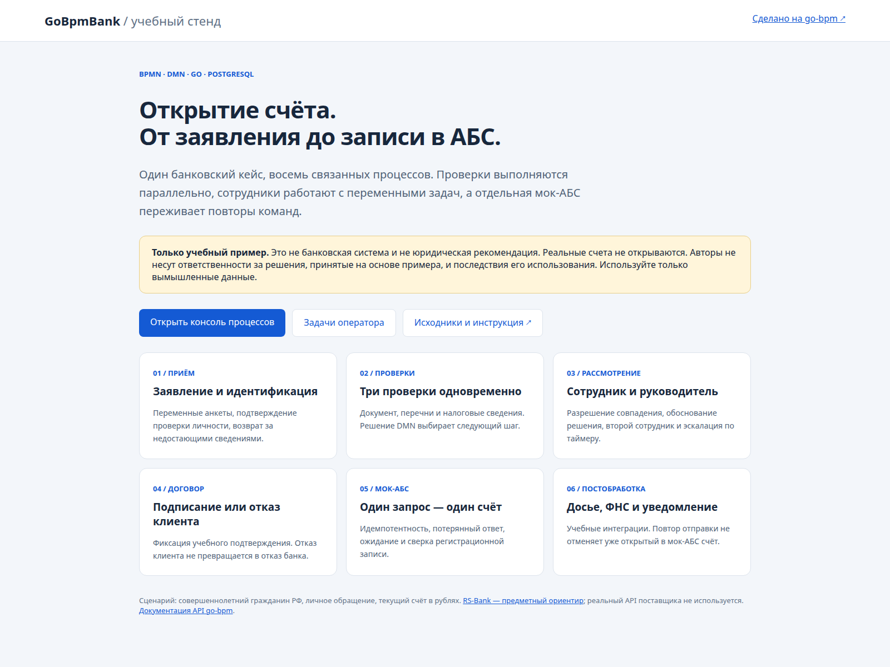

# GoBpmBank

**Тестовый процесс открытия счёта для небольшого банка.** Самостоятельный клон [go-bpm](https://github.com/nicolas-vp/go-bpm) со своим движком, генератором, API и веб-консолью. Базовые демопримеры и зависящие от них тесты удалены. В экземпляре зарегистрированы только восемь банковских процессов.

> **Только для учебных целей.** Пример не является банковским продуктом, юридической консультацией или готовым регламентом открытия счетов. Авторы не несут ответственности за решения, принятые на основе примера, и последствия его использования. Реальные счета не открываются, сведения государственным органам не отправляются. Используйте только вымышленные данные.



## Введение

Новый совершеннолетний гражданин РФ лично обращается за текущим рублёвым счётом для личных нужд. Сотрудник заполняет анкету, процессы выполняют автоматические проверки, DMN выбирает маршрут. При необходимости заявление рассматривают финансовый мониторинг и руководитель. После учебного подтверждения подписания договора отдельная мок-АБС регистрирует счёт; затем выполняются досье, сообщение ФНС и уведомление — тоже моки.

Мы показываем не набор несвязанных BPMN-элементов, а полный сценарий: возврат за сведениями, несколько ролей, параллельные проверки, дочерние экземпляры, таймеры, юридически различимые исходы и повтор вызова внешнего сервиса без дублирования счёта.

## Документация

1. [Этапы проектирования и архитектура](docs/design.md).
2. [Подпроцессы и переменные](docs/processes.md).
3. [Законодательная основа и границы примера](docs/legal.md).
4. [Запуск и прохождение пользовательских задач](docs/walkthrough.md).
5. [Мок-АБС, идемпотентность и сбои](docs/integrations.md).
6. [Проверки, результаты и скриншоты](docs/verification.md).

## Быстрый запуск

Нужны Docker с Compose v2; для локальной сборки — Go 1.26+. Вариант с готовым PostgreSQL описан в [инструкции](docs/walkthrough.md).

```sh
cp .env.example .env
# Задайте собственный пароль POSTGRES_PASSWORD в .env.
docker compose up -d --build
```

- Учебный стенд: http://localhost:8090/
- Консоль: http://localhost:8090/ui/
- Мок-АБС: http://localhost:8091/healthz

Базы `bank` и `bank_core` отдельные; данные сохраняются в собственном томе `gobpmbank_bankdata`. Команды не подключаются к существующему демо go-bpm. Порты опубликованы только на localhost.

### Начать заявление

Откройте вкладку «Запуск» в консоли, выберите учебный сценарий и нажмите «Запустить». ID заявления можно оставить пустым: будет создан UUID. Альтернатива через API:

```sh
curl -X POST http://localhost:8090/bank/api/applications \
  -H 'Content-Type: application/json' \
  -d '{"applicationId":"9d98cf8e-a182-4b29-adb5-f8e2bd91a721","scenario":"happy"}'
```

Одинаковые ID и команда возвращают тот же экземпляр. Пользовательские задачи выполняются через стандартную консоль go-bpm: взять задачу и заполнить переменные. **Отдельных форм и formKey нет.** Учебные пользователи: `operator`, `aml`, `chief`. Группы определяются сервером.

## Сборка и проверки

```sh
make generate   # локальный генератор этого репозитория; исходники BPMN/DMN в process/
make build
make test
make vet
make e2e        # запущенные bank и mock на localhost:8090/8091; Python 3, без зависимостей
```

Сквозные тесты добавляют только учебные заявления и не очищают базы. Независимые интеграционные тесты движка используют `GO_BPM_TEST_DSN` и **очищают указанную тестовую базу**; не направляйте их в `bank` или любую рабочую БД. Без переменной они пропускаются. Тест мок-АБС с PostgreSQL включается через `MOCK_TEST_DSN`.

## На чём основан пример

[Документация go-bpm](https://go-bpm.tech/docs/): [BPMN](https://go-bpm.tech/docs/bpmn/), [DMN](https://go-bpm.tech/docs/dmn/), [генератор](https://go-bpm.tech/docs/generator/), [HTTP API и задачи](https://go-bpm.tech/docs/api/), [эксплуатация](https://go-bpm.tech/docs/running/).

В качестве предметного ориентира небольшого банка рассматривается [RS-Bank v.5.5 от R-Style Softlab](https://www.softlab.ru/products/rs-bank/). Наша мок-АБС использует собственный учебный REST-контракт: это не реальная интеграция с RS-Bank, не имитация его протокола и не заявление о партнёрстве с поставщиком. Доказанного актуального рейтинга «самая популярная АБС небольших банков» мы не приводим.

Нормативные источники: 204-И, 115-ФЗ, 499-П, 860-П, ГК РФ, НК РФ и 152-ФЗ — со ссылками и оговорками в [законодательном разборе](docs/legal.md).

Исходная версия движка: `73e9a5a25c1606f95bbdff667a20169fcd419505`. Импорты переведены на `github.com/nicolas-vp/go-bpm-bank`; пространство имён BPMN `gobpm` сохранено для совместимости с моделлером. Соседний checkout движка для сборки не требуется. Apache-2.0, см. [LICENSE](LICENSE) и [NOTICE](NOTICE).
