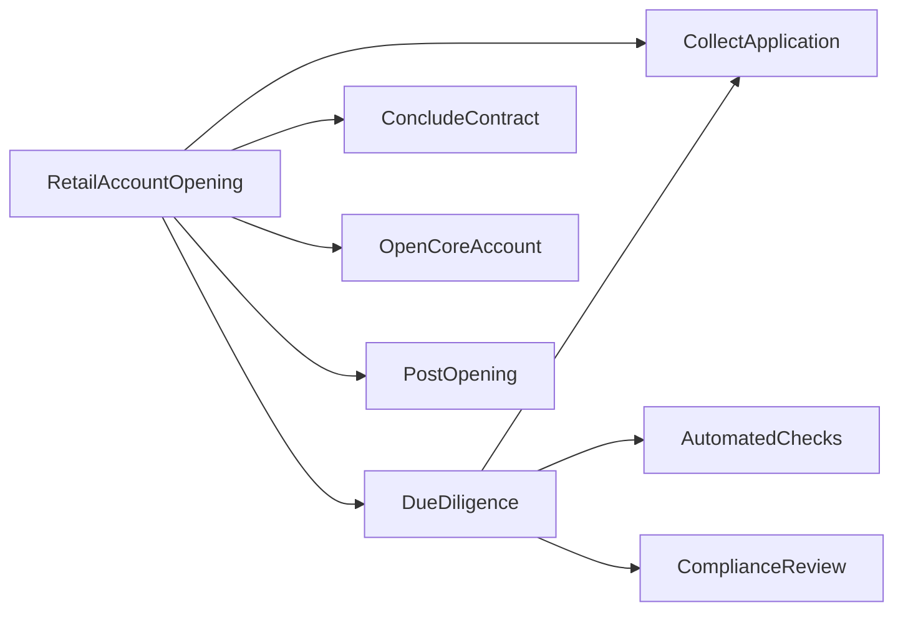
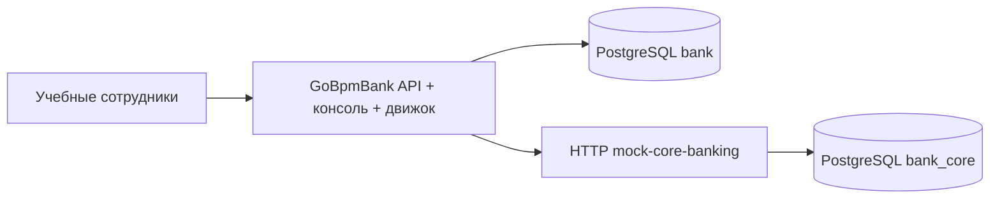

# Этапы проектирования GoBpmBank

> Учебный пример. Авторы не несут ответственности за решения на его основе и последствия использования. Пример не заменяет юридическую экспертизу и банковские правила.

## Этап 1. Предметная область

Результат: сценарий нового совершеннолетнего гражданина РФ при личном обращении за текущим рублёвым счётом. Исключены несовершеннолетние, представители, иностранцы, дистанционная идентификация, вклад, кредит, выпуск карты. Для них требуется отдельное проектирование. Неподдерживаемый случай — `REFERRED`, а не отказ банка.

Требования законодательства, учебные правила банка и технические сбои — разные категории. Источники и дата исследования 2026-11-04 зафиксированы в [legal.md](legal.md).

## Этап 2. Декомпозиция

Главный процесс — `RetailAccountOpening`. Семь вызываемых процессов: `CollectApplication`, `DueDiligence`, `AutomatedChecks`, `ComplianceReview`, `ConcludeContract`, `OpenCoreAccount`, `PostOpening`. Связь через call activity, у дочерних экземпляров сохраняются родитель и бизнес-ключ заявления.

Результат: [BPMN/DMN](../process/) с диаграммами, [каталог шагов](processes.md). Верхний уровень читается как история заявления, технические детали спрятаны в дочерних процессах.

## Этап 3. Архитектура

Результат: собственный клон go-bpm, два Go-бинарника, две отдельные базы. Engine/queue/API/webui находятся в этом репозитории. Ни внешняя библиотека go-bpm, ни соседняя рабочая копия не нужны. `upstream` — исходный go-bpm, `origin` — go-bpm-bank. Исходная история и Apache-2.0 сохранены; прежние демопримеры и зависимые тесты удалены.

## Этап 4. Правила и задачи

Результат: DMN `OnboardingRoute`, hit policy FIRST, маршруты CONTINUE / REQUEST_INFO / REVIEW. DMN не принимает юридический отказ. Сотрудники завершают user task переменными через стандартный API; форм нет. Сервер проверяет поля, типы, допустимые решения и роль при взятии задачи. Для специального рассмотрения проверяющий и согласующий различаются.

Демо-личность выбирается параметром `userId`; это не промышленная аутентификация. Группы из запроса claim игнорируются, роли берутся из учебного серверного справочника.

## Этап 5. Интеграции и надёжность

Результат: идемпотентные заявление и команда открытия, сохранение операций мок-АБС в БД, сверка потерянного ответа, таймер опроса отложенного открытия, повтор постобработки. [Подробности](integrations.md).

Особенность типизированной модели go-bpm: обработчик сериализует все поля. Поэтому параллельные проверки используют обёртку области записи в `internal/bankapi/queues.go`: каждая возвращает только собственные поля результатов вместе с общими входными данными. Старые/нулевые результаты соседних проверок удаляются до join. Сквозной тест неполной анкеты проверяет этот эффект.

## Этап 6. Реализация и испытания

Результат: десять сквозных сценариев, проверки полей задач, сохранения идемпотентности после пересоздания мок-сервиса и независимые тесты движка. Ошибка HTTP не превращается в отказ клиенту; отклонение команды АБС — `REFERRED_CORE`. Открытый счёт остаётся открытым при сбое постобработки.

Подписание моделируется подтверждением сотрудника и синтетической ссылкой. Перечни, налоговые проверки, ФНС и уведомления — моки. Условные минуты SLA не объявляются сроками закона. Стенд не считается готовой банковской системой.

## Этап 7. Документация и скриншоты

Результат: введение в README, инструкция прохождения, законодательный разбор, каталог процессов и реальные снимки запущенного стенда. [Проверки и изображения](verification.md).

## Этап 8. Страница go-bpm.tech

Следующий отдельный этап: «Тестовый процесс открытия счёта для небольшого банка». Использовать README как введение, дерево подпроцессов, скриншоты, ссылки на этот репозиторий и документацию движка. Учебная оговорка должна быть видна до описания процесса. В текущую реализацию публикация страницы не входит.
