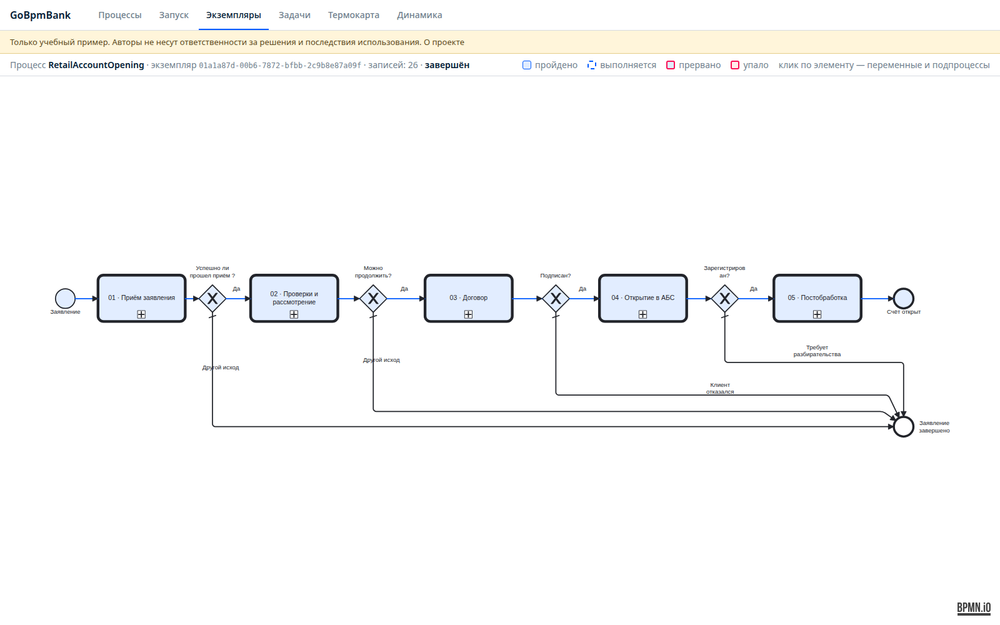
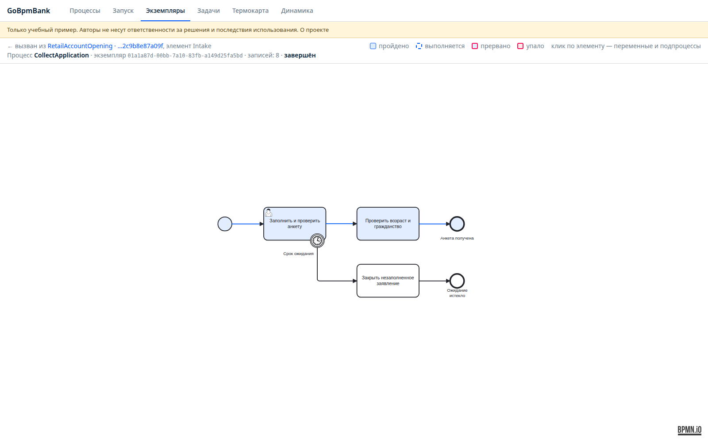
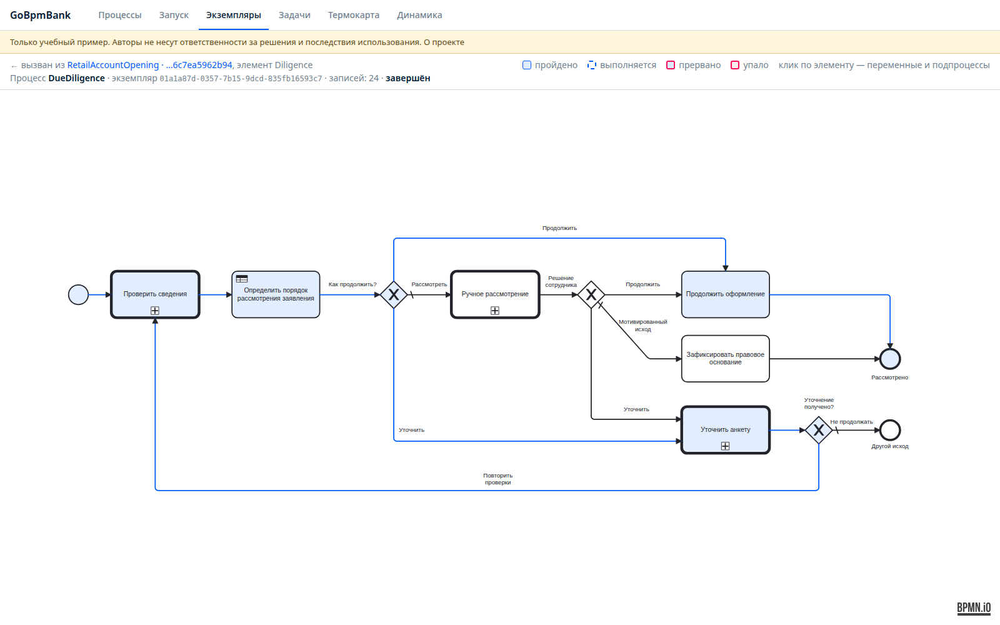
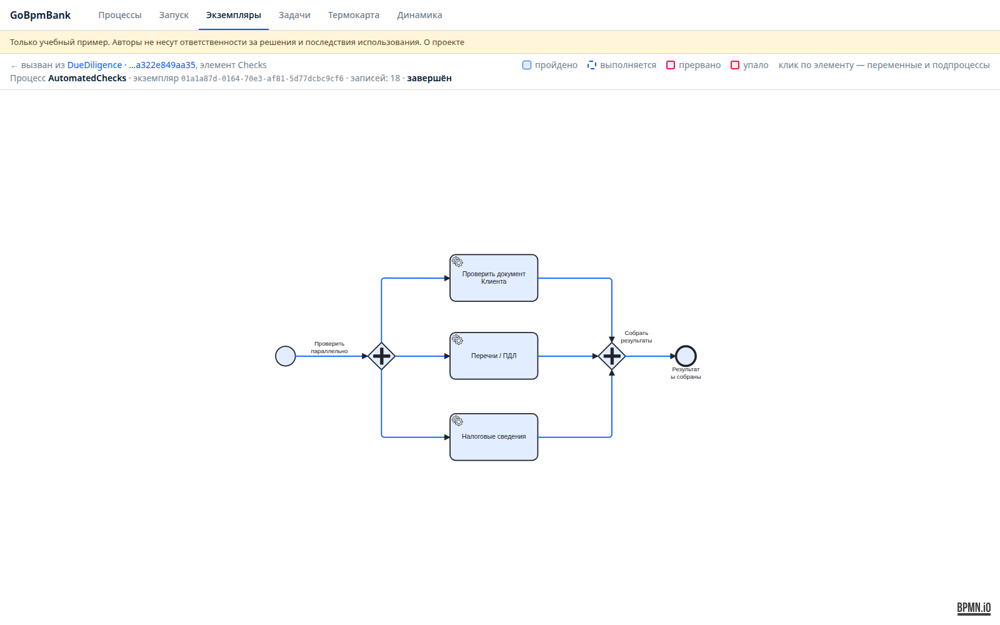
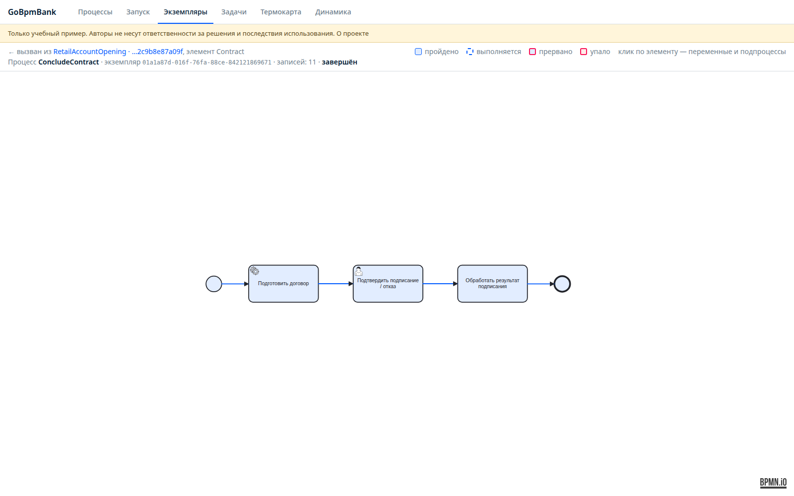
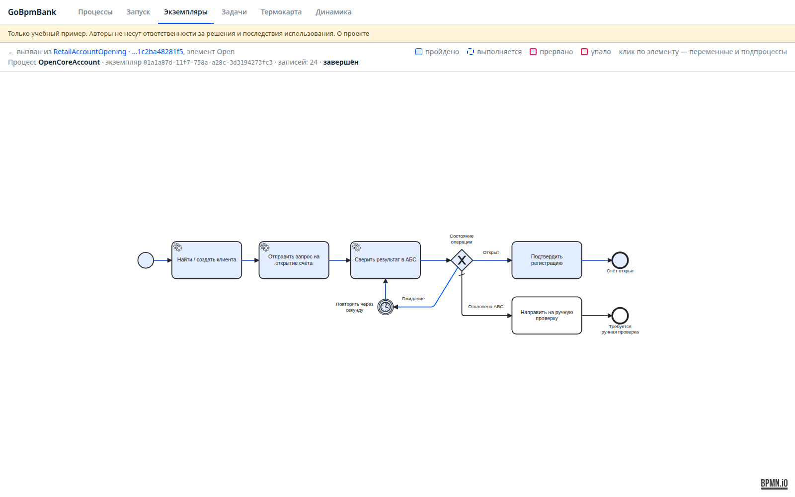
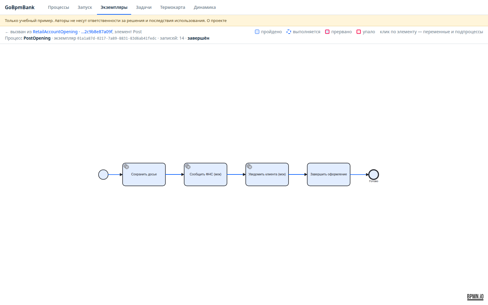

# Подпроцессы и переменные

> Только учебный пример. Авторы не несут ответственности за решения на его основе и последствия использования.

## Верхний уровень

[RetailAccountOpening.bpmn](../process/RetailAccountOpening.bpmn): заявление → приём → проверки/рассмотрение → договор → открытие в АБС → постобработка. Шлюзы после этапов проверяют бизнес-исход, а не технический статус дочернего экземпляра. Дочерний экземпляр может успешно завершить свою работу с исходом отказа клиента.

## CollectApplication — приём и идентификация

[BPMN](../process/CollectApplication.bpmn). `IdentifyApplicant`, группа operators, заполняет анкету и подтверждение личной идентификации. `ValidateApplication` проверяет границы учебного сценария: гражданство RU и возраст не менее 18 лет. Выход за границы — REFERRED. Граничный таймер PT5M отменяет незавершённую задачу и фиксирует CLOSED_INCOMPLETE; это учебный SLA.

Переменные: applicantName, birthDate (YYYY-MM-DD), citizenship, passportRef (синтетическая ссылка), address, purpose, taxResidency, identityVerified, documentsComplete. Для уточнения вызывается заново тот же процесс. Системные результаты проверок через эту задачу изменить нельзя.

## DueDiligence — проверки и маршрутизация

[BPMN](../process/DueDiligence.bpmn). Вызывает AutomatedChecks, выполняет [решение DMN](../process/routing.dmn), затем продолжает оформление, вызывает CollectApplication для уточнения или ComplianceReview. После исправления анкеты повторяются все три проверки. Если уточнение завершилось иным исходом, процесс не продолжает открытие.

DMN FIRST: неполный документ → REQUEST_INFO; документ на разбор, совпадение/ПДЛ или налоговые сведения на разбор → REVIEW; все три проверки положительные → CONTINUE; неизвестная комбинация → REVIEW. Это учебные правила маршрутизации v1, не полный банковский риск-профиль.

## AutomatedChecks — параллельные проверки

[BPMN](../process/AutomatedChecks.bpmn). Fork запускает три HTTP service task. Каждая ветка приходит в join независимо от делового результата; сетевые ошибки повторяются очередью. Поля принадлежат отдельным веткам: documentStatus/documentEvidence, screeningStatus/screeningEvidence, taxStatus/taxEvidence. Evidence содержит requestId, checkedAt и source.

## ComplianceReview — ручное рассмотрение

[BPMN](../process/ComplianceReview.bpmn). Начало нового рассмотрения сбрасывает прошлые разрешения и исполнителей. `ReviewClient` для aml: reviewDecision = CONTINUE / REQUEST_INFO / DECLINE / REFER, reason, legalBasisCode. При учебном PEP и CONTINUE требуется `AuthorizeClient` для chief: authorized, reviewDecision, reason. reviewedBy и authorizedBy заполняются сервером. Эскалация по таймеру не разрешает продолжить PEP-кейс без первого рассмотрения. Совпадение имени можно разрешить как ложное; оно само по себе не вызывает отказ.

Учебный каталог содержит одно основание отказа: NK142_4_NO_TAX_DATA при налоговых сведениях REVIEW, после рассмотрения сотрудником. Иные ситуации можно передать специалисту (REFER) или запросить сведения. При PT2M ожидания ReviewClient задача отменяется и передаётся руководителю. Это внутренний учебный срок.

## ConcludeContract — договор

[BPMN](../process/ConcludeContract.bpmn). Мок готовит contractId, оператор передаёт contractAccepted и signedDocumentRef. Согласие без ссылки не принимается. При false результат WITHDRAWN. Подтверждение — моделирование факта, а не электронная подпись и не юридически действительный договор.

## OpenCoreAccount — открытие в мок-АБС

[BPMN](../process/OpenCoreAccount.bpmn). Найти/создать customerId → сверить/послать идемпотентную команду → опросить operationId. При PENDING ждёт PT1S и повторяет опрос. При OPENED обязательны accountId и registeredAt; только после этого accountOpened=true. Иной ответ операции — REFERRED_CORE, не юридический отказ клиенту.

## PostOpening — постобработка

[BPMN](../process/PostOpening.bpmn). Архив → учебное сообщение ФНС → уведомление. Идемпотентные HTTP-эффекты и повторы очереди. Основной процесс ждёт завершения подпроцесса, но accountOpened уже зафиксирован. Постоянный сбой после исчерпания повторов потребует операционного вмешательства; автоматического закрытия счёта нет.

## Исходы заявления

| outcome | Смысл |
|---|---|
| OPENED | Мок-АБС подтвердила регистрацию, постобработка завершена |
| DECLINED_WITH_BASIS | Учебное мотивированное решение с применимым основанием |
| WITHDRAWN | Клиент отказался от договора |
| CLOSED_INCOMPLETE | Истёк учебный срок ожидания анкеты |
| REFERRED | Ситуация за границами примера / передана специалисту |
| REFERRED_CORE | Операция АБС требует разбирательства |

Статус экземпляра completed говорит о завершении BPMN, а не обязательно об открытии счёта. Бизнес-исход ищите в переменной outcome в истории последней задачи. Статус failed — техническая ошибка процесса, отдельная от отказа клиенту.

Дополнительное чтение: [call activity и параллельные шлюзы](https://go-bpm.tech/docs/bpmn/), [DMN](https://go-bpm.tech/docs/dmn/), [история и user task API](https://go-bpm.tech/docs/api/).
