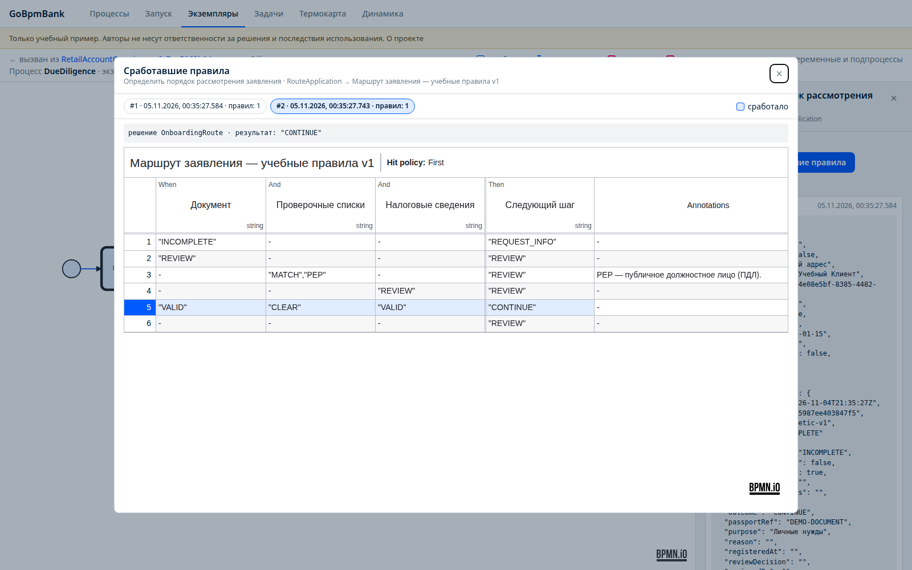
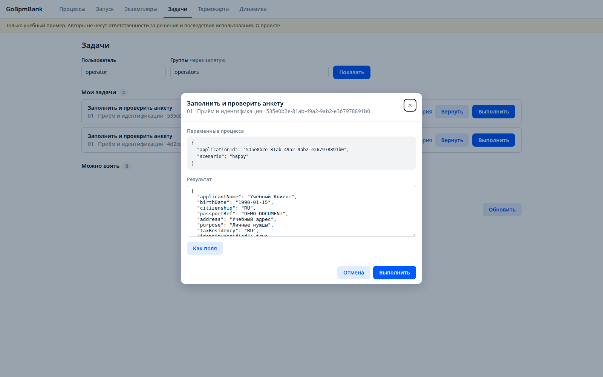

# Проверки и скриншоты

> Только учебные цели. Авторы не несут ответственности за решения на основе примера и последствия использования. Положительный результат тестов не подтверждает нормативную полноту реального банковского решения.

Проверено 4 ноября 2026 года: локальная сборка GoBpmBank, отдельные процессы bank и mock-core-banking, две базы PostgreSQL 16.15. Для независимых интеграционных тестов движка использована третья изолированная база. Базовые Test*-процессы отсутствуют в коде приложения и в каталоге запуска.

## Обновление схем 5 ноября 2026 года

После ручной правки раскладки и названий пересоздан только Go-код, выполнены сборка, `go test ./...`, `go vet ./...` и все 10 сквозных сценариев. Скриншоты обновлены по новым диаграммам; добавлены снимки приёма заявления, договора и постобработки. В DMN-примечании отображается «PEP — публичное должностное лицо (ПДЛ)».

В AutomatedChecks согласованы недостающие incoming/outgoing в XML шлюзов с уже существующими sequenceFlow. Координаты, точки линий и названия сохранены; блок диаграммы при этой технической правке проверен побайтно. `scripts/design.py` не запускался.

## Выполненные проверки

| Проверка | Результат |
|---|---|
| Генерация банковских BPMN/DMN локальным go-bpm-gen | Успешно |
| Сборка двух бинарников | Успешно |
| go vet ./... | Успешно |
| go test -race -p 1 ./... с отдельной тестовой БД | Успешно |
| Защита полей и типов пользовательских задач | Успешно |
| Ограничения отказа и разные проверяющий/согласующий | Успешно |
| Защита PEP-кейса от обхода первого рассмотрения при эскалации | Успешно |
| Повтор открытия после пересоздания серверного объекта мок-АБС с той же PostgreSQL | Тот же счёт, одна операция |
| Повтор заявления | Тот же instanceId; изменение команды даёт 409 |
| Повтор команды АБС | Тот же accountId; изменение команды даёт 409 |
| Браузер: запуск заявления, взятие задачи и открытие редактора переменных | Успешно |

Полный прогон с race выполнен до последней доработки сброса согласований. После неё повторно выполнены тесты bankapi/сгенерированных процессов, go vet и все 10 сквозных сценариев. Docker/Compose-конфигурация подготовлена, но её запуск в этом окружении не проверялся: доступ к Docker-демону отсутствует. Испытания выполнялись нативными Go-бинарниками.

## Сквозные сценарии

Скрипт [scripts/e2e.py](../scripts/e2e.py) выполняет реальные HTTP-запросы к запущенному банку и отдельному мок-сервису. Он не очищает БД, для каждого заявления создаёт новый UUID, проверяет статус корневого процесса, историю, бизнес-исход, количество операций и отсутствие неподходящих побочных эффектов.

| Сценарий | Бизнес-исход | Что проверено |
|---|---|---|
| happy | OPENED | Анкета, параллельные проверки, DMN, договор, АБС, постобработка |
| incomplete | OPENED | Две задачи анкеты, повторные проверки; потеря результата при join исключена |
| screening_match | OPENED | Ручное разрешение учебного совпадения |
| pep | OPENED | Проверка aml и отдельное согласование chief |
| tax_refusal | DECLINED_WITH_BASIS | Допустимое учебное основание, АБС не открывает счёт |
| withdrawn | WITHDRAWN | Отказ клиента, АБС не вызывается |
| lost_response | OPENED | Регистрация до потерянного ответа, восстановление без второго счёта |
| core_pending | OPENED | Как минимум два опроса, BPMN-таймер между ними |
| core_reject | REFERRED_CORE | Отдельный интеграционный исход вместо отказа физлицу |
| tax_report_retry | OPENED | Повтор подтверждения того же эффекта ФНС, счёт остаётся открытым |

Результаты последнего прогона: [e2e-results.json](e2e-results.json). В них только синтетические идентификаторы и счётчики истории. При повторном прогоне UUID будут отличаться.

## Скриншоты

Сняты с работающего приложения в headless Chrome. Главная — 1600×1200, остальные — 1600×1000. Без дорисовки и монтажа. В сценарии задачи поля заполнялись в реальном стандартном JSON-редакторе; задача не была отправлена ради скриншота.

| Файл | Что показывает |
|---|---|
| [01-home.png](images/01-home.png) | Введение, учебная оговорка и этапы |
| [02-processes.png](images/02-processes.png) | Только восемь банковских процессов |
| [03-main-process.png](images/03-main-process.png) | Успешно выполненный верхний уровень |
| [04-due-diligence.png](images/04-due-diligence.png) | Возврат анкеты и повторное прохождение |
| [05-parallel-checks.png](images/05-parallel-checks.png) | Три service task и join |
| [06-core-opening.png](images/06-core-opening.png) | Отложенное открытие через таймер |
| [07-dmn-context.png](images/07-dmn-context.png) | Контекст подпроцесса с DMN |
| [07-dmn-rules.png](images/07-dmn-rules.png) | Реальная таблица с подсветкой сработавшего правила и двумя вызовами после уточнения |
| [08-compliance.png](images/08-compliance.png) | Рассмотрение и согласование руководителем |
| [09-start.png](images/09-start.png) | Запуск через прикладной идемпотентный API из консоли |
| [10-user-tasks.png](images/10-user-tasks.png) | Очередь задач оператора |
| [11-task-variables.png](images/11-task-variables.png) | Завершение задачи переменными без специальной формы |
| [12-intake.png](images/12-intake.png) | Приём заявления, возраст и гражданство |
| [13-contract.png](images/13-contract.png) | Договор и обработка результата подписания |
| [14-post-opening.png](images/14-post-opening.png) | Досье, ФНС и уведомление |





## Воспроизведение

```sh
make generate
make build
make test
make vet
# Запустить банк и мок-АБС по walkthrough.md.
make e2e

# Отдельный Chrome для снимков; без расширений и личного профиля.
google-chrome --headless --no-sandbox --remote-debugging-port=9229 \\
  --user-data-dir=/tmp/gobpmbank-screenshots about:blank
# В другом терминале:
python3 scripts/screenshots.py
```

Python-скрипты используют только стандартную библиотеку. Снимки создаются через DevTools, скрипт проверяет готовность диаграмм и отсутствие ошибки страницы. [Манифест](screenshot-manifest.json) сохраняет размеры и синтетические идентификаторы экземпляров снимков. Полное выполнение банковских SLA PT2M/PT5M в сквозной десятке не ожидалось; базовые механизмы таймеров проверяются независимыми тестами движка.
